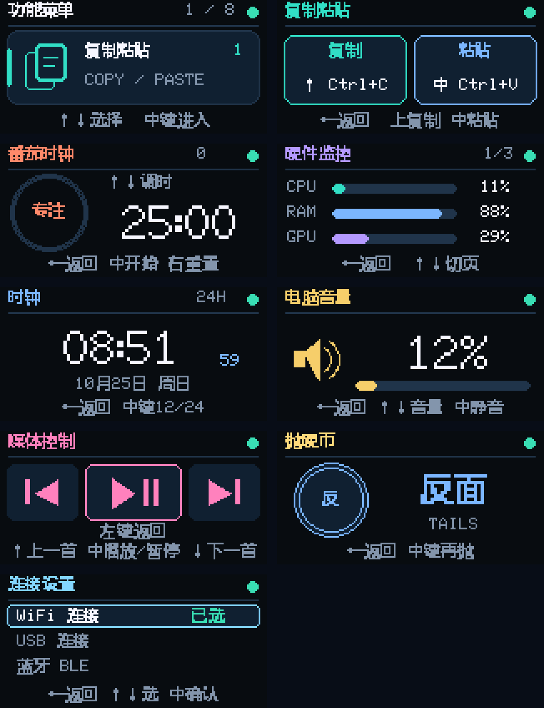
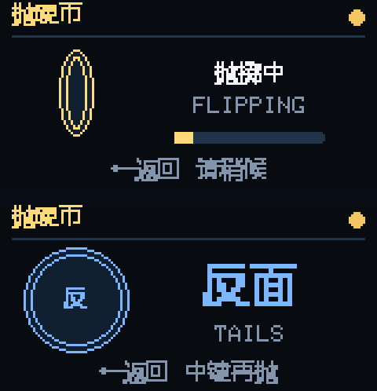

# ESP32-C3 七功能三连接桌面控制器

适用于合宙 CORE-ESP32-C3 + Air101 0.96 英寸 TFT / 五向按键板，使用 VS Code + PlatformIO（Arduino C++）开发。提供 WiFi、USB 串口、蓝牙 BLE 三种电脑连接方式，在屏幕“设置”页切换并保存。电脑接收端支持 Windows 10/11、Python 3.10及以上；USB和蓝牙依赖见 pc/requirements.txt。

界面参考 [Super knob](https://gitee.com/wenzhengclub/super_knob) 的多功能控制器形式，为 160×80 横屏重新绘制中文卡片、彩色图标和进度环。下图来自实物固件的画面缓冲区：

## 按键操作

上电进入功能菜单。上、下键循环切换七个功能和“设置”，中键进入，左键从任意页面返回菜单。

| 界面 | 上键 | 下键 | 中键 | 左键 | 右键 |
| --- | --- | --- | --- | --- | --- |
| 功能菜单 | 上一个功能 | 下一个功能 | 进入选中的功能 | 保持菜单 | — |
| 复制粘贴 | Ctrl+C | — | Ctrl+V | 返回菜单 | — |
| 番茄时钟 | 未开始时加5分钟 | 未开始时减5分钟 | 开始 / 暂停 / 继续 | 返回菜单，继续计时 | 重置计时 |
| 硬件监控 | 上一页数据 | 下一页数据 | 下一页数据 | 返回菜单 | — |
| 时钟 | — | — | 12/24小时制 | 返回菜单 | — |
| 电脑音量 | 加2% | 减2% | 静音 / 取消静音 | 返回菜单 | — |
| 媒体控制 | 上一首 | 下一首 | 播放 / 暂停 | 返回菜单 | — |
| 抛硬币 | — | — | 抛一次，显示正面 / 反面 | 返回菜单 | — |
| 设置 | 上一种连接 | 下一种连接 | 确认并保存 | 返回菜单 | — |

菜单和音量页支持长按上下键连续调节。复制 / 粘贴每次按下只发送一次，按住不会反复粘贴。进入复制粘贴页时只打开界面，中键再次按下才发送 Ctrl+V。

当前工程按用户本地调整后的方向使用：**上13、下8、中4、左9、右5**。屏幕为 SCK2、SDA3、RES10、DC6、CS7、BL11。完整接线及版本说明见 [硬件说明](docs/hardware.md)。

## 七个功能

### 复制粘贴

作用于电脑当前获得焦点的应用。选中文字后，在本页按上键复制，再将光标放到目标位置按中键粘贴。电脑接收程序必须保持运行。

回执显示“已发送”代表 Windows 接受了完整的组合键按下 / 松开序列，不能证明目标软件已完成剪贴板操作。无选择内容、应用权限或焦点不同都会影响结果。复制通常不会弹出提示，应通过粘贴确认。

### 番茄时钟

默认专注25分钟、休息5分钟，阶段结束后自动进入下一阶段，边框短暂闪烁提示。右上角记录完成的专注轮数。计时以毫秒差计算，不受系统时钟校时影响，返回菜单后继续计时。

尚未开始时，上下键按5分钟调整专注时长，范围5～90分钟。开始后要改时长，先按右键重置。重置保留已调整的专注时长和累计轮数；断电后重新开始，不保存计时进度。

### 硬件监控

每秒从电脑获取一次数据，共三页：

1. CPU、内存、GPU 使用率。
2. CPU 温度、GPU 温度、系统盘使用率。
3. 显存、内存、系统盘使用率。

CPU / 内存 / 系统盘使用 Windows 原生接口读取；NVIDIA GPU 的负载、温度和显存通过已安装的 nvidia-smi 读取。数据过期或电脑断线时显示离线 / 等待状态，未支持的传感器显示“--”。

CPU 温度及其他显卡可选接入 **LibreHardwareMonitor**：运行该程序，并启用本机端口8085的 Web Server。接收端只查询 127.0.0.1:8085/data.json，不要求安装它才能运行其他功能。某些传感器是否可读仍取决于驱动、硬件和该程序权限。

### 时钟

默认北京时间 UTC+8、24小时制，显示时分秒、月日和星期。WiFi 连通后自动启动 NTP 网络校时；电脑接收程序也可提供时间。校时后即使电脑暂时离线，时钟继续走时；断电重启后需要重新校时。

### 电脑音量

控制 Windows 当前默认播放设备的主音量，每次上下键调节2%，自动限制在0～100%。中键切换静音，屏幕显示电脑实际返回的音量。切换播放设备后，后续操作使用新的默认设备。

### 媒体控制

上键上一首、下键下一首、中键播放 / 暂停，左键返回菜单。每次按下只发送一次，按住不会连续切歌。使用 Windows 标准媒体键，播放器需要支持系统媒体按键；上一首 / 下一首表示曲目切换。屏幕显示发送回执，不推测播放器当前处于播放还是暂停。

媒体键定义参考 [Microsoft Virtual-Key Codes](https://learn.microsoft.com/en-us/windows/win32/inputdev/virtual-key-codes)。新增功能需要新版电脑接收端；升级固件后也要重启接收程序。

所有中文标签已从12×12缩小为10×10。字模先完整采集笔画，再按边界居中装入字符格，修复标题和按钮文字被截断的问题；大号时间和音量数字保持原有大小。

### 抛硬币

菜单选中“抛硬币”，中键进入；再次按中键抛一次，硬币先翻转约1.2秒，从快到慢，伴随轻微上抛和进度条，结束后以较大中文显示“正面”或“反面”。左键可在动画中立即返回菜单，动画在后台结束。按住中键只抛一次，动画期间再次按中键也不会重抛；结束后松开再按可抛下一次。返回菜单再进入时保留上次结果；断电清空。此功能在板端完成，不需要电脑接收程序。

动画通过毫秒时间推进，约每35毫秒重绘一帧，不用延时循环阻塞按键和计时。随机结果在触发时采样一次，动画仅负责呈现，结束后显示这次采样的结果。

实物画面（上：翻转中；下：落定）：

每次抛掷都调用 `esp_random()` 读取新的32位硬件随机数，用最低位映射：1为正面，0为反面。两种结果各对应一半的32位数值，无取模偏差；不使用固定种子，也不按计数、时间或前一次结果强制交替。随机序列允许连续多次相同，短期次数也不保证各占一半。

按[乐鑫 ESP32-C3 随机数文档](https://docs.espressif.com/projects/esp-idf/en/v4.4.7/esp32c3/api-reference/system/random.html)要求维持熵源：三连接版本保持WiFi射频初始化，蓝牙栈也已初始化；USB和蓝牙模式无需连接WiFi路由器。桌面指令和硬件数据只走当前选中的连接。

## 设置连接方式

菜单进入“设置”，上、下键选择，按中键确认。高亮表示光标，“已选”表示当前连接；确认后立即切换并写入NVS，重启保留。左键返回不确认光标所在的新选项。首次启动默认WiFi。

| 模式 | 电脑侧要求 | 使用方法 |
| --- | --- | --- |
| WiFi | 板子和电脑处于互通局域网 | 保持原有WiFi和电脑IP配置，运行接收程序 |
| USB | USB数据线、CH343驱动、电脑接收程序 | 自动查找CH343串口；也可指定 --usb-port COM3 |
| 蓝牙BLE | Windows蓝牙适配器、电脑接收程序 | 自动扫描 ESP32C3-Macropad 并建立加密连接，系统若提示配对则确认 |

三种方式均支持复制粘贴、音量、媒体控制、硬件监控和电脑校时。番茄钟、抛硬币及其动画在板端运行。切换会清除旧连接的在线状态，未发出的旧按键和旧回执不会跨连接补发；网络或连接恢复也不会自动重发一次按键。

这块CH343版开发板通过USB串口与接收程序通信。ESP32-C3的USB外设是固定功能Serial/JTAG；蓝牙使用BLE数据服务。因此，USB和蓝牙模式也需要运行电脑接收程序，硬件监控数据和操作回执由它提供。

## 配置与启动

打开本目录的 esp32c3-wifi-macropad.code-workspace，安装推荐的 PlatformIO IDE 扩展。

先双击 **pc/install_requirements.cmd**，它会在工程的 .venv 中安装USB和BLE依赖。已有配置无需重新生成；后续双击 **pc/start_receiver.cmd** 会自动使用该环境。

电脑与板子需要处于互通的局域网。板子连接2.4GHz WiFi；电脑可以是同一路由器上的有线、2.4GHz 或5GHz连接。

在工程终端运行：

~~~powershell
python tools/configure.py
~~~

输入 WiFi 名称、密码和**电脑在该局域网中的 IPv4**，可用 ipconfig 核对。VPN 和虚拟网卡的地址不适合作为电脑接收地址。

配置工具生成 include/secrets.h 和 pc/receiver_config.json，两端使用相同的随机令牌。文件已被 .gitignore 排除。已有正确配置时不必重新运行；重新配置会更新令牌，需要重新烧录并重启接收程序。

首次只用USB或蓝牙、暂不配置WiFi时，可运行 `python tools/configure.py --no-wifi`，仍需生成匹配的认证令牌。之后在板端“设置”选择USB或蓝牙。当前已有配置的用户无需执行此命令。

在 PlatformIO 侧栏使用 Build / Upload，或用 VS Code 所使用的 PlatformIO 环境：

~~~powershell
& "$env:USERPROFILE\.platformio\penv\Scripts\platformio.exe" run
& "$env:USERPROFILE\.platformio\penv\Scripts\platformio.exe" run --target upload --upload-port COM4
~~~

COM4 是本次检测到的开发板端口，更换电脑时应在设备管理器中确认。上传前关闭占用串口的工具。GPIO8、GPIO9参与启动配置，正常上电 / 复位时释放全部方向键。

电脑端双击 **pc/start_receiver.cmd**，或在普通 Windows / VS Code 终端运行：

~~~powershell
python pc/receiver.py
~~~

保持接收程序运行，操作复制粘贴时将焦点切回目标应用。默认同时启用WiFi、USB、BLE；电脑端可以用 `.venv\Scripts\python.exe pc/receiver.py --links wifi` 只运行WiFi，或用 `--links usb,ble` 只运行USB和蓝牙。USB和BLE会复用本机执行接口，操作序号统一去重；BLE连接加密，并校验基于共享令牌的HMAC握手证明，串口和BLE消息不传输原始令牌。

接收程序的USB线程会占用CH343串口，烧录、串口监视或抓图前请退出接收程序，或用 `--links wifi,ble` 启动以释放USB串口。默认TCP端口8765；WiFi模式下Windows防火墙若提示，为当前可信的专用网络允许Python访问。程序不会自动修改防火墙，不要把接收端口映射到公网。

右上角状态点：绿色表示当前连接收到电脑状态；黄色表示连接正在等待接收程序或认证；红色表示当前无线连接尚未建立。状态超过5秒未更新会离线，硬件页不继续展示旧读数。番茄钟和抛硬币可在电脑离线时继续使用。

## 常见状态

| 显示 / 日志 | 含义与处理 |
| --- | --- |
| 电脑离线 | 检查接收程序、电脑IP、网络和防火墙 |
| 未配置网络 | 先生成配置，再编译烧录 |
| 已发送 | 电脑已确认执行发送接口 |
| 权限受限 | Windows 拒绝发送输入，检查接收程序运行环境及目标应用权限 |
| 认证错误 | 两端令牌不一致，重新核对配置 |
| 发送失败 | 电脑端执行失败，查看接收程序日志；音量页也可能表示播放设备不可用 |
| 结果未知 | 网络超时；不会自动重发，先查看目标应用再决定是否重按 |
| 过期取消 / 队列忙 | 本次操作未发送，避免离线后延迟粘贴或堆积音量操作 |
| 硬件数据 -- | 该传感器暂不可用，不代表真实读数为0 |

若日志显示 Windows error 5，先关闭在受限后台环境运行的接收进程，再从 Windows 桌面双击启动脚本，或用普通 VS Code 终端启动。向管理员应用发送按键需要接收程序具有相同权限，见 [Microsoft SendInput](https://learn.microsoft.com/en-us/windows/win32/api/winuser/nf-winuser-sendinput)。

## 验证与画面抓取

~~~powershell
python -m unittest discover -s tests -v
python tools/check_keyboard_input.py
python tools/check_media_input.py
python tools/capture_ui.py --port COM4 --check-controls
~~~

自动测试使用模拟键盘 / 音量。快捷键输入检查会短暂打开自己的窗口，验证真实 Ctrl+C；不读取或修改用户剪贴板。媒体输入检查通过接收程序发送三个媒体键，并用临时钩子拦截注入的媒体键，验证按下 / 松开序列，不向播放器传递测试指令。画面抓取会检查菜单、番茄钟、媒体页映射及抛硬币操作，保存实物画面到 docs/previews，完成后返回菜单，不发送复制粘贴、音量或媒体操作。`UI TEST COIN`使用独立对象验证两种映射、连续同面和页面行为，并输出256次硬件采样计数；不要求计数严格各半。

本次构建、实物和接口验证结果见 [验证记录](docs/validation.md)。

| 文件 | 用途 |
| --- | --- |
| src/main.cpp | 按键扫描、后台 HTTP、时间同步、串口诊断 |
| src/pc_link.cpp | WiFi/USB/BLE连接、切换隔离、认证、回执、状态同步 |
| include/pc_link.h | 连接管理器接口 |
| include/device_ui.h | 七功能菜单、页面和动画绘制 |
| include/pomodoro.h | 专注 / 休息计时逻辑 |
| include/coin_flip.h | 硬件随机抛硬币，等概率正面 / 反面 |
| include/ui_font.h | 小屏中文字符子集，已随源码提供 |
| include/board_config.h | 按键 GPIO、消抖和长按参数 |
| include/display_setup.h | 屏幕 SPI、方向和面板版本 |
| pc/receiver.py | 认证、事件去重、快捷键及状态接口 |
| pc/device_links.py | USB和BLE电脑端连接线程、分帧和统一执行 |
| pc/requirements.txt | USB/BLE的Python依赖 |
| tools/check_device_links.py | 实物USB/BLE双向通信检查；读取真实状态、拦截桌面动作 |
| pc/system_status.py | Windows 硬件采样及默认播放设备音量 |
| tools/make_ui_font.py | 用 Windows 已安装字体重新生成所需字符 |

界面使用 TFT_eSprite 缓冲后整帧推送，依赖固定版本 TFT_eSPI 2.5.43、ArduinoJson 6.21.5、NimBLE-Arduino 2.3.6。无需把参考项目的电机驱动或LVGL工程移植到这块组合板。
